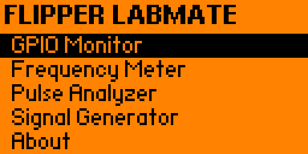
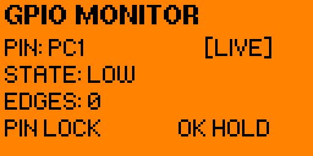
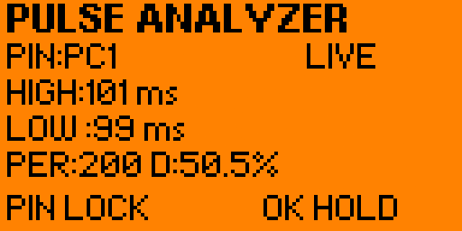

# LabMate

**Digital signal diagnostics for Flipper Zero · Built for Momentum Firmware**

[](https://github.com/sehmusadsoy-ui/flipper-labmate/releases/tag/v1.8)
[](https://github.com/sehmusadsoy-ui/flipper-labmate/releases/tag/v1.8-e11-custom-momentum)
[](https://flipperzero.one/)
[](LICENSE)


*LabMate concept artwork — the depicted interface is illustrative, not an actual application screenshot. Check the [release notes](https://github.com/sehmusadsoy-ui/flipper-labmate/releases) for real supported features and firmware compatibility.*

**Measure · Generate · Record · Diagnose**

LabMate turns a Flipper Zero into a compact, offline toolkit for **3.3 V digital signals**. It combines frequency and pulse measurements, GPIO state inspection, real edge counting, PWM output, button timing, microSD logging, saved profiles and UART diagnostics in **one application**.

Designed for practical fault-finding, honest measurements, clear controls and predictable cleanup of hardware resources. **It is not an analog oscilloscope or a certified measurement instrument.**

[**Get the current Stable**](https://github.com/sehmusadsoy-ui/flipper-labmate/releases/tag/v1.8) ·
[**Explore the E11 Custom Edition**](https://github.com/sehmusadsoy-ui/flipper-labmate/releases/tag/v1.8-e11-custom-momentum) ·
[**Documentation**](docs/) ·
[**Roadmaps**](ROADMAP.md) ·
[**Türkçe özet**](docs/README_TR.md)

---

## Choose the right release

| Edition | Recommended for | Download |
| :--- | :--- | :--- |
| **v1.8 Stable** — ordinary Latest | Flipper Zero with a **compatible Momentum SDK/API**; original verified integrated UART/PWM/logger tools | [Download FAP and SHA256](https://github.com/sehmusadsoy-ui/flipper-labmate/releases/tag/v1.8) |
| **v1.8 E11 — Custom Momentum** — prerelease | **Only an independently verified, exactly matched E11-patched Momentum firmware/native-resource environment**; expanded I²C / 1-Wire and resource-owner experiments | [Review binaries, compatibility and risks](https://github.com/sehmusadsoy-ui/flipper-labmate/releases/tag/v1.8-e11-custom-momentum) |
| **Older versions** | Historical behaviour, compatible prior Momentum builds or explicitly tested rollback | [Browse all Releases](https://github.com/sehmusadsoy-ui/flipper-labmate/releases) |

> [!IMPORTANT]
> **Firmware compatibility comes first.** An FAP built for one Momentum firmware/API is not guaranteed to run on another build, on official Flipper firmware, or on Unleashed/Xtreme and other custom firmware. In particular, the **E11 FAP does not work as a standalone update on unpatched Momentum**. Its full firmware package is labeled **expert review only**; exact previous custom-firmware rollback and firmware-wide compatibility are not proven. Read the release-specific instructions before changing your device.

**Release integrity**

- Ordinary v1.8 Stable: `labmate.fap` · SHA256 `119c44bb854030a73a60fa205d38770bf77f048bb166ab379a03135c1de5f3b0`
- E11 Custom Edition: `LabMate-v1.8-E11-CUSTOM-MOMENTUM.fap` · SHA256 `393fe3e52aa710162a42d7299aa053f538b2ee1ad6542755cf402b83c1931b61`
- Previous GitHub Releases and their source tags are retained. **v1.1 was a development milestone, not an independently published v1.1 release.**

## Instruments

| Instrument | What it does | Availability |
| :--- | :--- | :--- |
| **GPIO Monitor** | Inspect digital HIGH/LOW and edge activity | Stable / E11 |
| **Frequency Meter** | LOW PC1 or HIGH PB3 measurement, LIVE/HOLD, measured MIN/MAX | Stable / E11 |
| **Pulse Analyzer** | HIGH/LOW time, period, duty, extrema and selected GPIO inputs | Stable / E11 |
| **PWM Studio** | TIM1 / PA7 output, 5–95% duty, 1 Hz–50 kHz presets and custom rate | Stable / E11 |
| **Event Counter** | Count actual PB3 rising edges using TIM2 | Stable / E11 |
| **Button Analyzer** | Measure PC1 button transitions and debounce/settling | Stable / E11 |
| **Threshold Alerts** | Visual limits for supported digital measurements | Stable / E11 |
| **Data Logger / Log History** | Record selected measurements to numbered CSV files on microSD; review history | Stable / E11 |
| **Profiles** | Save/load/delete three CRC-protected configuration slots | Stable / E11 |
| **UART Terminal** | 9600 / 38400 / 115200 baud, receive counters and explicit TX | Stable / E11 |
| **I²C Explorer + 1-Wire** | External bus scan and optional DS18B20 sensor path | **E11 matched custom firmware only; positive external sensor tests still pending** |

The Flipper menu is organized as:

```text
MEASURE → OUTPUT → RECORDS → COMM → INFO
                                 About is always last
```

## Quick start

1. Open [Releases](https://github.com/sehmusadsoy-ui/flipper-labmate/releases) and **choose the edition that matches your firmware**. Verify the FAP SHA256 listed in that release.
2. Back up your existing LabMate FAP and `/ext/apps_data/labmate/` (Profiles and Logger CSV), especially before switching versions. Never overwrite the only known-good backup.
3. On a verified compatible Momentum firmware, place the matching FAP at `/ext/apps/Tools/labmate.fap`. Close LabMate, stop PWM/recording/UART and perform the copy safely; do **not** copy a patched E11 FAP to unpatched firmware.
4. Launch **Apps → Tools → LabMate**. Check **INFO / About** and start with a safe 3.3 V test signal.

### Safe digital loopback

The built-in PWM generator can be routed to the frequency/pulse input when the relevant GPIO modes are stopped:

```text
Flipper PA7 (PWM output) ── known-safe jumper ── PC1 (frequency / pulse input)
```

Choose a low-frequency 50% waveform to validate basic timing. **Generator-to-meter loopback shares the device's timing references: this is a functional check, not independent calibration.**

> [!CAUTION]
> **Flipper GPIO is 3.3 V only.** Never connect unverified voltages, 5 V logic, vehicle power lines, mains or hazardous signals directly. Use a verified level shifter/isolation and proper ground/reference where required. Only handle GPIO wiring when the involved tools are safely stopped.

## Validation and limitations

The normal v1.8 Stable FAP was built and checked against its pinned Momentum development SDK and accepted on a physical Flipper (**19/19 user-reported scoped checks**). The exact E11 final FAP was independently checksummed, then tested on **one already-matched patched Momentum setup**: on-device UI, ESP32-S2 UART at 115200, PA7→PC1 PWM/Frequency/Pulse at 100 Hz and 1 kHz / 50%, STOP–RESTART and isolated fresh CSV/Profile persistence were reported **PASS**.

Evidence levels are deliberately distinct: **operator-observed physical tests, source/host tests, CI/build evidence, and deferred hardware tests are not interchangeable**. External I²C positive ACK, DS18B20 conversion, independent oscilloscope calibration/OFF voltage, comprehensive native third-party conflict tests, exceptional microSD failures and exact firmware restoration remain unverified.

[Ordinary v1.8 device acceptance](docs/V1_8_STABLE_CANDIDATE.md) ·
[E11 scope and release evidence](https://github.com/sehmusadsoy-ui/flipper-labmate/blob/dev/v1.8-completion/docs/V1_8_E11_FINAL_RELEASE_GATE_2026-10-17.md) ·
[Deferred hardware test register](docs/DEFERRED_HARDWARE_TESTS.md)

## Roadmap — toward LabMate 2.0

| Version | Focus | Status |
| :--- | :--- | :--- |
| **v1.5** | Data Logger / CSV History | Historical Stable released |
| **v1.6 / 1.6.1** | Modular app, guarded Profiles and local resource ownership | Historical Stable released; global native co-ownership not universally proven |
| **v1.7** | PWM Studio, true counter, Button Analyzer and alerts | Historical Stable released |
| **v1.8** | UART, Counter RESUME; separately published E11 custom I²C/1-Wire branch | Ordinary Stable + scoped E11 prerelease published |
| **v1.9** | **Digital Logic Scope and Signal Compare**: actual edge timestamps, bounded buffers, triggers and tolerances | Planned; [engineering Draft](https://github.com/sehmusadsoy-ui/flipper-labmate/pull/15) |
| **v2.0** | **LabMate Ultimate / Signal Doctor**: measurement-based fault reasoning, integrated dashboard and polished workflow | Planned |

**Both approved roadmaps are maintained together:**

[Original product milestones (`ROADMAP.md`)](ROADMAP.md) ·
[Quality & firmware compatibility addendum](docs/MASTER_ROADMAP_V2_ADDENDUM.md) ·
[Pre-v1.9 open-work audit](docs/V1_9_PRESTART_TWO_ROADMAP_AUDIT_2026-10-17.md)

The original feature roadmap determines **what gets built**; the addendum governs **how it is validated**. No Premium licensing concept may replace the v2.0 Signal Doctor goals without a separate decision.

## Source & development

```text
flipper-labmate/
├── application.fam        # App manifest
├── src/                   # Integrated application source
├── tests/                 # Host/native regressions
├── scripts/               # Verified build and maintenance tools
├── docs/                  # Engineering notes and release checks
├── screenshots/           # Historical UI captures
└── .github/workflows/     # CI and archived release workflows
```

**Development branches are not release binaries.** The ordinary `main` branch matches the original stable application line. Expanded E11 native code is reviewed separately in [Draft PR #13](https://github.com/sehmusadsoy-ui/flipper-labmate/pull/13); v1.9 planning in [Draft PR #15](https://github.com/sehmusadsoy-ui/flipper-labmate/pull/15) does not mean Logic Scope is implemented.

For local development, use an **API-matched Momentum Firmware** checkout, copy the manifest, icon and full `src/` directory into `applications_user/labmate/`, and build with:

```bash
./fbt APPSRC=applications_user/labmate
```

The E11-only code additionally depends on matched native firmware patches; it is **not** supported by copying app sources into an arbitrary Momentum checkout.

Detailed historical controls, legacy install snippets and original notes remain preserved in the [pre-redesign README archive](docs/archive/README_PRE_2026-10-17_LANDING.md).

## Screenshots

<details>
<summary>View historical UI examples (v1.0–v1.2 era, not screenshots of the current v1.8/E11 release)</summary>

| Menu | GPIO Monitor | Pulse |
| :---: | :---: | :---: |
|  |  |  |

</details>

## Maintainer & license

Maintained by **SauronLAB / Sehmus**. Licensed under the [MIT License](LICENSE). Contributions and bug reports should identify the **exact Flipper firmware build, LabMate release tag/FAP SHA256, reproduction steps and relevant logs**; do not post private SD data or credentials.

[**Latest ordinary Stable**](https://github.com/sehmusadsoy-ui/flipper-labmate/releases/latest) · [**E11 Custom Momentum**](https://github.com/sehmusadsoy-ui/flipper-labmate/releases/tag/v1.8-e11-custom-momentum) · [**Releases archive**](https://github.com/sehmusadsoy-ui/flipper-labmate/releases)
